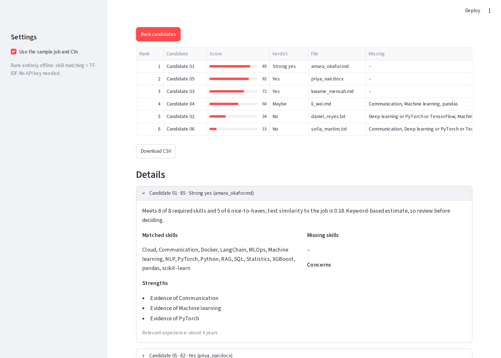
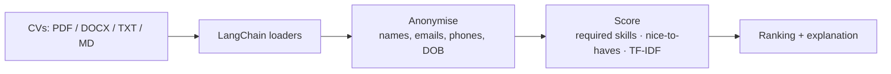

# Resume Screening Tool with LangChain

Rank a pile of CVs against a job description in seconds. Every CV is anonymised, then scored on the job's required skills, nice-to-haves and text similarity, with an explainable breakdown. Runs fully offline: no API key, no cost.



## How it works



1. **Load:** custom LangChain `BaseLoader`s turn PDFs, Word files and text into `Document`s.
2. **Blind screening:** names, emails, phone numbers, links and personal fields (date of birth, gender, nationality…) are removed before anything is scored.
3. **Score:** each CV is scored on the job's required skills (60%), nice-to-haves (15%) and TF-IDF similarity (25%). Either/or requirements like *"PyTorch or TensorFlow"* count once.
4. **Explain:** every result is a validated Pydantic `CandidateAssessment` with the score, verdict, matched and missing skills, strengths and concerns.

## Quick start

```bash
python -m venv .venv && source .venv/bin/activate
pip install -r requirements.txt

python -m resume_screener --job samples/job_description.md --resumes samples/resumes --csv ranking.csv

# web app
streamlit run app.py
```

Output on the sample data:

```
 #  Candidate     Score  Verdict    File
------------------------------------------------------------
 1  Candidate 01     85  Strong yes amara_okafor.md
 2  Candidate 05     82  Yes        priya_nair.docx
 3  Candidate 03     72  Yes        kwame_mensah.md
 4  Candidate 04     60  Maybe      li_wei.md
 5  Candidate 02     34  No         daniel_reyes.txt
 6  Candidate 06     15  No         sofia_martins.txt
```

The six sample CVs are fictional and cover a deliberate spread: a strong ML engineer, a senior data scientist, a graduate, an NLP researcher, a data analyst and a frontend developer.

## Responsible use

- **Decision support, not decision making.** Scores help prioritise reading; a person should review every candidate and make every decision.
- **Anonymised by default.** Scoring never sees names, contact details or personal fields. Anonymisation reduces bias but is not a guarantee, since names can appear inside free text.
- **Explainable.** Every score comes with the matched and missing skills behind it.
- **Keyword-based.** It rewards CVs that name the skills; a strong candidate who describes them differently can score lower, so read beyond the top of the list.
- Automated screening is regulated in some places (for example UK GDPR Article 22 and the EU AI Act, which treats recruitment AI as high-risk). Check what applies before using this on real applicants.

## Project structure

```
resume_screener/
├── loaders.py     # LangChain document loaders (PDF, DOCX, TXT, MD, uploads)
├── anonymize.py   # blind-screening redaction
├── offline.py     # skill extraction + TF-IDF scorer
├── pipeline.py    # anonymise → score → rank
├── schema.py      # CandidateAssessment (Pydantic)
└── cli.py         # command line
app.py             # Streamlit UI
samples/           # sample job description + 6 fictional CVs
tests/             # unit tests
```

## Tests

```bash
pip install -r requirements-dev.txt
pytest
```

## Tech stack

Python · LangChain (core) · Pydantic · scikit-learn (TF-IDF) · pypdf · Streamlit · pytest
