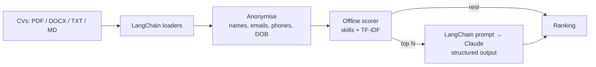

# Resume Screening Tool with LangChain + Claude

Rank a pile of CVs against a job description in seconds. A free keyword + TF-IDF pass scores every CV, then Claude reads the shortlist and returns a structured, evidence-based assessment of each candidate.


## How it works



1. **Load:** custom LangChain `BaseLoader`s turn PDFs, Word files and text into `Document`s.
2. **Blind screening:** names, emails, phone numbers, links and personal fields (date of birth, gender, nationality…) are removed before anything is scored.
3. **Offline pass (free):** each CV is scored on the job's required and nice-to-have skills (either/or requirements like *"PyTorch or TensorFlow"* count once) plus TF-IDF similarity.
4. **Claude pass:** only the top *N* go to Claude through a LangChain `ChatPromptTemplate`. The Anthropic SDK's structured outputs return a validated `CandidateAssessment` (score, verdict, matched and missing skills, strengths, concerns), so there's no JSON parsing to break.
5. **Rank:** Claude-assessed candidates are re-ranked; if Claude declines one, it keeps its offline score instead of disappearing.

Cost scales with the shortlist, not the applicant pool.

## Quick start

```bash
python -m venv .venv && source .venv/bin/activate
pip install -r requirements.txt

# works immediately, no API key needed
python -m resume_screener --job samples/job_description.md --resumes samples/resumes --offline

# with Claude assessing the top 5
export ANTHROPIC_API_KEY=sk-ant-...
python -m resume_screener --job samples/job_description.md --resumes samples/resumes --shortlist 5 --csv ranking.csv

# web app
streamlit run app.py
```

Offline output on the sample data:

```
 #  Candidate     Score  Verdict    Scored by  File
------------------------------------------------------------------------
 1  Candidate 01     85  Strong yes offline    amara_okafor.md
 2  Candidate 05     82  Yes        offline    priya_nair.docx
 3  Candidate 03     72  Yes        offline    kwame_mensah.md
 4  Candidate 04     60  Maybe      offline    li_wei.md
 5  Candidate 02     34  No         offline    daniel_reyes.txt
 6  Candidate 06     15  No         offline    sofia_martins.txt
```

The six sample CVs are fictional and cover a deliberate spread: a strong ML engineer, a senior data scientist, a graduate, an NLP researcher, a data analyst and a frontend developer.

## Responsible use

- **Decision support, not decision making.** Scores help prioritise reading; a person should review every candidate and make every decision.
- **Anonymised by default.** Claude is told never to infer or mention protected characteristics and not to penalise career breaks. Anonymisation reduces bias but is not a guarantee, since names can appear inside free text.
- **Explainable.** Every score comes with the matched and missing skills and the evidence behind strengths and concerns.
- Automated screening is regulated in some places (for example UK GDPR Article 22 and the EU AI Act, which treats recruitment AI as high-risk). Check what applies before using this on real applicants.

## Project structure

```
resume_screener/
├── loaders.py     # LangChain document loaders (PDF, DOCX, TXT, MD, uploads)
├── anonymize.py   # blind-screening redaction
├── offline.py     # skill extraction + TF-IDF scorer
├── claude.py      # LangChain prompt → Claude structured output
├── pipeline.py    # anonymise → shortlist → assess → rank
├── schema.py      # CandidateAssessment (Pydantic)
└── cli.py         # command line
app.py             # Streamlit UI
samples/           # sample job description + 6 fictional CVs
tests/             # 9 tests; the Claude client is mocked, so no API calls
```

## Tests

```bash
pip install -r requirements-dev.txt
pytest
```

## Tech stack

Python · LangChain (core) · Claude (Anthropic SDK, structured outputs) · Pydantic · scikit-learn · pypdf · Streamlit · pytest
